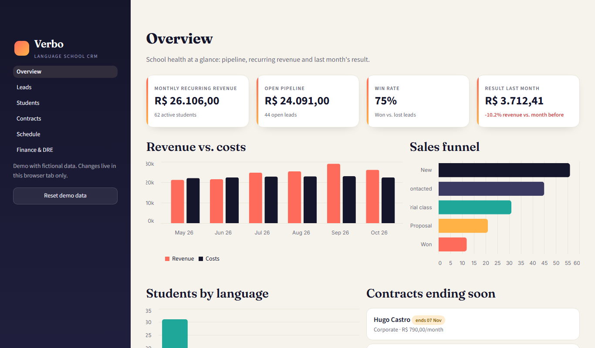
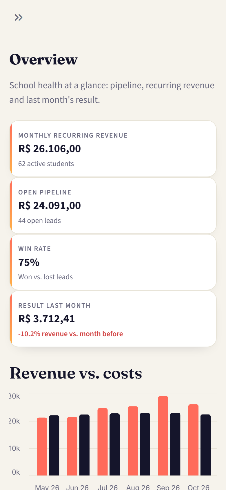
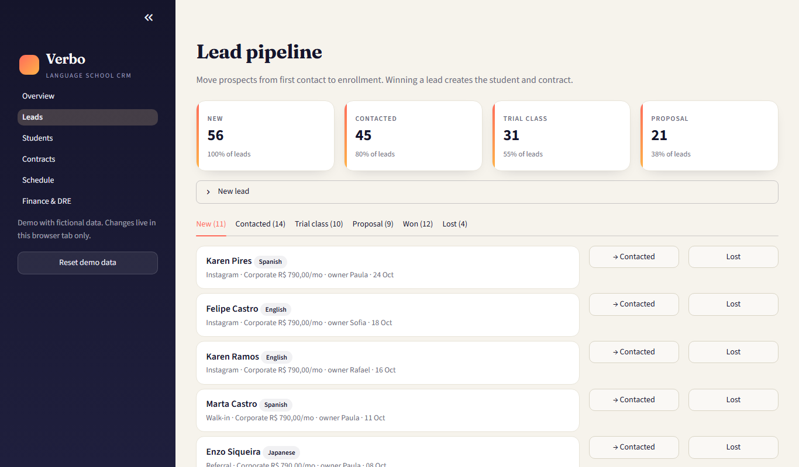
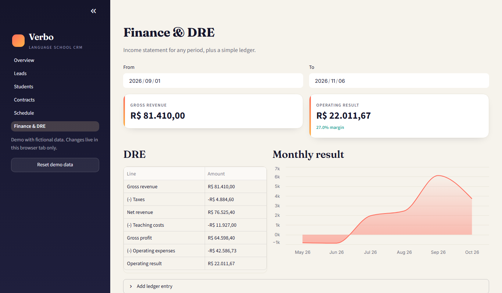

# Verbo — CRM for a language school, in Python

A small CRM/back-office for a language school: sales funnel, students, recurring contracts, weekly timetable and a monthly income statement (DRE) with charts. Written in **Python with Streamlit**, and it runs **entirely in the browser** (Pyodide via stlite), so it can live on GitHub Pages with no server.

**Live demo:** https://alissonlittig.github.io/verbo-crm/ (first load takes ~20 s while Python starts in your browser)





## Features

- **Overview** — recurring revenue (MRR), open pipeline value, win rate, last month's result, revenue vs. costs, sales funnel, students by language, contracts ending soon.
- **Leads** — one tab per stage (New → Contacted → Trial class → Proposal → Won / Lost), one-click stage moves, validated "new lead" form. Winning a lead creates the student and a 12-month contract, so MRR updates immediately.
- **Students** — search plus language and status filters.
- **Contracts** — active / ending soon / expired, recurring revenue by plan.
- **Schedule** — week timetable by day, seat occupancy and open seats per class.
- **Finance & DRE** — income statement for any date range (gross revenue → taxes → net revenue → teaching costs → gross profit → operating expenses → result), monthly result chart, ledger and an "add entry" form.
- Responsive down to 390 px, no horizontal scroll.

All data is fictional and generated deterministically in `app/data.py`. Changes live in the browser tab only; "Reset demo data" restores the seed.




## Stack

Python 3.12, Streamlit, pandas, Altair, stlite (Streamlit on Pyodide, loaded from a CDN), pytest, GitHub Actions + GitHub Pages.

## Layout

```
app/streamlit_app.py   entry point: navigation + sidebar
app/views.py           the six pages
app/services.py        pure business rules (funnel, MRR, DRE, lead moves) — no Streamlit
app/data.py            seeded fictional data
app/theme.py           brand CSS and chart styling
scripts/build.py       embeds app/*.py into dist/index.html for stlite
scripts/shots.py       headless browser check + screenshots (needs playwright)
tests/                 unit tests for services + AppTest smoke run of every page
```

## Run it

```bash
pip install -r requirements-dev.txt
streamlit run app/streamlit_app.py     # normal Streamlit server
python -m pytest -q                    # business rules + every page renders
python scripts/build.py                # builds dist/index.html (static, stlite)
python -m http.server -d dist 8000     # then open http://localhost:8000
```

CI runs the tests, builds `dist/` and deploys it to GitHub Pages on every push to `main`.

## Notes

- Money is in BRL, formatted the Brazilian way. Taxes in the DRE use a single flat 6% rate to keep the demo readable.
- Data is not persisted: a real deployment would swap the in-memory frames in `views.db()` for a database.

MIT licensed.
